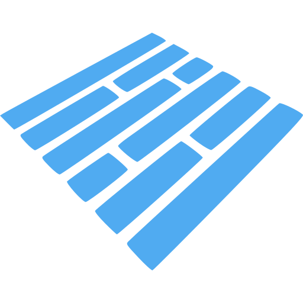
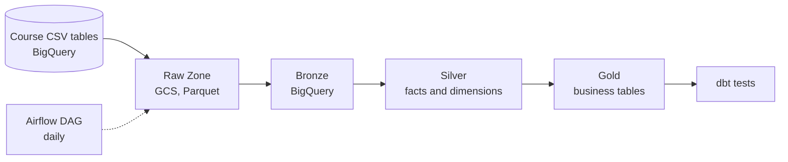

# StyleHub Data Pipeline

A learning project that moves online shop data into BigQuery. The data passes through Raw, Bronze, Silver and Gold layers on Google Cloud.

## Tech Stack

| Category | Technologies |
|---|---|
| **Programming** |  Python  •  SQL  •  python-dotenv |
| **Data Storage** |  Google Cloud Storage  •   BigQuery  •   PostgreSQL (source)  •   Parquet |
| **Data Processing** |  pandas  •   PyArrow |
| **Transform & Orchestration** | dbt (dbt-bigquery)  •  Apache Airflow |
| **Tooling** |  uv  •  Ruff  •   pytest |
| **DevOps** |  Docker and Docker Compose  •   GitHub Actions  •  pre-commit  •  gitleaks |

> [!NOTE]
> This is a personal project built while following a 5-session data engineering course. The pipeline has run end to end on a real BigQuery project with the course CSV files, by hand and through Airflow. The Postgres and API code paths have **not** run on real sources. See [Troubleshooting & Limitations](#troubleshooting--limitations).

## Overview

**Problem.** StyleHub is a course dataset. It has four shop tables (users, products, orders, order_items) and an `events` table with about 108 million rows. There is no shipments file, so shipments are built from the dates on each order. Reports on the shop database can slow down the shop. The raw tables are also hard to use. Ids repeat, column types are loose, and each report may define "revenue" in its own way.

**Solution.** The pipeline copies raw data to cloud storage first. It loads the data into Bronze without changes. It then builds clean Silver tables, one row per fact or per thing. Gold tables answer business questions with clear rules. Each step runs alone and is safe to run again.

**Data Flow.** Course CSV tables (BigQuery) → Raw Zone (GCS) → Bronze → Silver → Gold. dbt builds Silver and Gold, and its tests are the checks. Airflow runs the steps each day. `events` goes through a one-time copy and a partitioned table.



## Architecture

### Code layers

| Layer | Responsibility | Files |
|---|---|---|
| Ingestion | Read the course tables. Write raw Parquet files. Nothing else. | `src/python/ingestion/csv_tables.py` (used by the pipeline). `database.py` (Postgres) and `api.py` are kept for a live source. |
| Load | Load the latest Raw batch of each day into Bronze. Build the big `events` table once. | `src/python/storage/load_bronze.py`, `events_bronze.py`, `copy_events.py` |
| Transform | Build Silver and Gold with dbt. dbt tests are the data checks. | `src/python/transform/run_dbt.py`, `dbt/` |
| Table setup | Run the SQL files of the Bronze layer (partitioned events). | `src/python/transform/run_sql.py`, `src/sql/` |
| Runner | Run all steps for one date. | `src/python/orchestration/run_daily.py` |
| Config | Read environment variables. Fill `${project}` and similar names in SQL. | `src/python/common/config.py` |

### Data layers

| Layer | Where | Contents |
|---|---|---|
| Raw Zone | GCS: `raw/stylehub/<table>/date=<date>/batch_id=<id>/` | Files as fetched. Each has `_ingested_at`, `_source` and `_batch_id`. |
| Bronze | BigQuery: `stylehub_bronze` | A copy of the source. One snapshot per day. |
| Silver | BigQuery: `stylehub_silver` | One latest row per id, with correct types. Built as a star schema. |
| Gold | BigQuery: `stylehub_gold` | Business tables that hold the rules. |

### Silver and Gold tables

| Table | Layer | What one row means |
|---|---|---|
| `fact_order_items` | Silver | One item in an order |
| `fact_orders` | Silver | One order |
| `fact_shipments` | Silver | One shipped order |
| `fact_events` | Silver | One event (view, cart, purchase). About 108 million rows. Incremental. |
| `dim_products` | Silver | One product |
| `dim_users` | Silver | One customer |
| `daily_revenue` | Gold | Orders and revenue for one day (no Cancelled orders) |
| `monthly_revenue_by_category` | Gold | Revenue and profit for one category in one month |
| `return_rate_by_state` | Gold | Share of returned orders in one state |
| `avg_delivery_days_by_state` | Gold | Average delivery time in one state |
| `daily_events_by_type` | Gold | Events, users and sessions for one day and one event type |
| `funnel_by_category` | Gold | Views, cart adds and purchases for one product category |

### dbt folders

The dbt folders follow the dbt Labs layout. The datasets and the step names keep the Silver and Gold names.

| dbt folder | Models | Dataset | Built by step |
|---|---|---|---|
| `models/staging/stylehub/` | 5 views `stg_stylehub__*`. Latest row per id, types cast. Only these call `source()` | `stylehub_silver` | `silver` |
| `models/intermediate/` | 2 views `int_*`: items with product cost, orders with item totals | `stylehub_silver` | `silver` |
| `models/marts/core/` | 6 tables: `dim_products`, `dim_users`, `fact_orders`, `fact_order_items`, `fact_shipments`, `fact_events` | `stylehub_silver` | `silver` |
| `models/marts/reporting/` | 6 tables, the Gold business tables | `stylehub_gold` | `gold` |

Tags, materialization and dataset are set per folder in `dbt/dbt_project.yml`. Each folder has its own `_<folder>__models.yaml`.

### Key design decisions

| Decision | How it works |
|---|---|
| Raw Zone is append-only | Each run writes a new file under a new `batch_id`. Nothing is overwritten. |
| Bronze keeps one batch per day | Running a day twice replaces that day's batch, so rows are not doubled. Each day stays as its own snapshot. Silver keeps the newest row of each id. |
| Latest row per id | Silver keeps the newest version of each id with `QUALIFY ROW_NUMBER()`. |
| Full load for CSV | The course CSV files have no `updated_at`, so every run reads whole tables. Silver keeps the latest row of each id. |
| Lookback window | Only for the Postgres path. It reads one extra day before the target date. |
| Rules live in Gold | Gold drops `Cancelled` orders. If the rule changes, rebuild Gold only. |
| Grain comes first | Each Silver file states its grain at the top. A check compares row count with distinct id count. |
| Partition and cluster | `events_partitioned` is split by day and clustered by `event_type` and `product_id`. It is built once; the course `events` table is in the US, so it is copied to Bronze first. |
| Incremental events | `fact_events` rebuilds the newest 3 days (`insert_overwrite` by `event_date`, variable `events_lookback_days`). Use `--full-refresh` to rebuild all. |
| Airflow operators | `ExternalPythonOperator` runs the Python steps (ingest, bronze) in a separate environment. `BashOperator` runs the dbt steps (silver, gold) through the CLI. `EmptyOperator` marks the start and the end. `PythonOperator` is not used, because Airflow pins library versions that clash with the pipeline. |
| Logic stays in SQL | SQL files hold the business logic. Python only runs them. |
| CTEs, no subqueries | Every SQL file uses CTEs. A test fails if it finds a subquery. |

## Project Structure

```
.
├── .github/
│   └── workflows/
│       ├── ci.yaml          # Checks that run on every push to main
│       ├── cd.yaml          # Pushes the image to Artifact Registry after CI
│       └── freshness.yaml   # Daily "did the pipeline run?" check (alert from outside Airflow)
├── data/                    # Your local course CSV files. Git ignores this folder.
├── deploy/                  # Everything that runs: one folder per part (compose file is in the root)
│   ├── pipeline/
│   │   ├── Dockerfile       # Image for the pipeline (CD publishes it)
│   │   └── run_on_vm.sh     # Run one pipeline step inside Docker on a VM
│   └── airflow/
│       ├── dags/stylehub_daily.py  # Daily DAG: start -> ingest -> bronze -> silver -> gold -> end
│       ├── Dockerfile       # Image for Airflow, with the pipeline packages inside
│       └── README.md        # How to run Airflow
├── dev/                     # Sample data for local tests (never deployed)
│   └── postgres/init/       # Seed SQL for the local Postgres
├── dbt/                     # Silver and Gold as dbt models, with tests
│   ├── models/              # dbt Labs layout, see the table below
│   │   ├── staging/stylehub/       # stg_stylehub__*: 1:1 with Bronze, latest row, cast types
│   │   ├── intermediate/           # int_*: joins and totals
│   │   └── marts/                  # core/ (dim_, fact_) and reporting/ (Gold business tables)
│   ├── tests/               # Checks that compare layers and test values
│   └── README.md            # How to run dbt
├── docs/
│   ├── README.md            # Start here: which page to read for which goal
│   ├── assets/              # Icons used in the README
│   ├── html/                # Pages to open in a browser
│   │   ├── architecture.html       # Data flow diagram
│   │   └── code-walkthrough.html   # Line-by-line guide to the main code
│   ├── design/              # Why the pipeline is built this way
│   │   ├── ARCHITECTURE.md  # Layers, star schema, Airbyte sync modes
│   │   ├── DECISIONS.md     # Design choices and measurements
│   │   ├── ETL_VS_ELT.md    # Why ELT, and what to change when a business rule changes
│   │   ├── EXTENDING.md     # How to add dbt, Airflow and Spark later
│   │   └── ROADMAP.md       # Plan by course session
│   └── ops/                 # How to run and ship it
│       ├── RUN_END_TO_END.md  # Step-by-step: run the whole pipeline
│       ├── CD.md              # Publish the image and let the VM pull it
│       ├── DEPLOY_VM.md       # Run the pipeline on a GCP VM
│       └── DEVOPS.md          # CI, Docker, pre-commit and what comes next
├── src/
│   ├── python/
│   │   ├── common/
│   │   │   ├── config.py            # Settings and SQL placeholders
│   │   │   └── retry.py             # Try again, with growing waits, after a short BigQuery or GCS error
│   │   ├── ingestion/               # 1. Ingestion: source -> Raw Zone, unchanged
│   │   │   ├── csv_tables.py        # Course tables -> Raw Zone: full load (used by the pipeline)
│   │   │   ├── schema_check.py      # Stop when the source changes its columns
│   │   │   ├── raw_writer.py        # Write Parquet and metadata columns to GCS
│   │   │   └── optional/            # NOT used by run_daily. Kept for a live Postgres or API source
│   │   │       ├── database.py      # Postgres -> Raw Zone: incremental or full load
│   │   │       ├── api.py           # StyleHub API -> Raw Zone
│   │   │       └── sources/         # The clients: postgres.py and stylehub_api.py
│   │   ├── storage/                 # 2. Storage: the daily Bronze steps
│   │   │   ├── load_bronze.py       # Raw Zone -> Bronze (latest batch of the day)
│   │   │   ├── copy_events.py       # Copy events from the US dataset to Bronze (one time)
│   │   │   ├── events_bronze.py     # Build events_partitioned if it is missing
│   │   │   └── setup/               # Run once by hand, not by run_daily (session 1)
│   │   │       ├── setup_gcp.py     # Create the bucket and the datasets
│   │   │       └── load_csv.py      # Local CSV -> bucket -> BigQuery
│   │   ├── transform/               # 3. Transform: dbt for Silver and Gold
│   │   │   ├── run_sql.py           # Run the SQL files of the Bronze layer
│   │   │   └── run_dbt.py           # Run dbt for Silver or Gold (models + tests)
│   │   └── orchestration/           # Runs the stages in order
│   │       ├── run_daily.py         # Run all steps for one date, with logs and alerts
│   │       ├── runs.py              # Save one row per step in BigQuery (keeps a file copy if that fails)
│   │       ├── alerts.py            # Send a message when a step fails
│   │       └── check_freshness.py   # Alert when no good run happened lately
│   ├── sql/
│   │   ├── bronze/                  # Table setup (partitioned events)
│   │   └── ops/                     # The pipeline_runs table
│   └── tests/                       # Same stages as src/python
│       ├── ingestion/               # Raw Zone writer, schema check, full load
│       │   └── optional/            # Postgres and API code: clients, window, integration tests
│       ├── storage/                 # Bronze load, events copy
│       │   └── setup/               # Bucket, datasets, CSV load
│       ├── transform/               # SQL files, dbt project, business rules
│       ├── orchestration/           # Run history, alerts, Airflow DAG
│       └── common/                  # Config
├── .dockerignore
├── .env.example             # Names of ALL settings (pipeline and Airflow). Copy to secrets/.env.
├── .gitignore
├── .pre-commit-config.yaml  # Checks that run before each commit
├── CLAUDE.md                # Rules for AI assistants and contributors
├── docker-compose.yaml      # ONE compose file. Profiles: dev (sample Postgres), pipeline, airflow
├── pyproject.toml           # Dependencies and tool settings
├── README.md
└── uv.lock                  # Exact package versions
```

> [!TIP]
> Read `CLAUDE.md` before you change code. It lists the rules for SQL, ingestion and secrets.

## Quick Start

### Prerequisites

| Item | Notes |
|---|---|
| Python 3.11 or newer | Check with `python --version`. |
| [uv](https://docs.astral.sh/uv/) | Installs the packages. |
| Google Cloud project | Turn on the BigQuery and Cloud Storage APIs. |
| GCS bucket | Holds the Raw Zone. |
| Four BigQuery datasets | `stylehub_bronze`, `stylehub_silver`, `stylehub_gold`, `stylehub_ops`. Use the same location as the bucket. `setup_gcp` creates them. |
| Service account key (JSON) | Save it in `secrets/`. Give the account BigQuery Job User, BigQuery Data Editor and Storage Object Admin. |
| Course CSV files | Five files in `data/raw_data/`. Git ignores them. Postgres access is only needed for the optional Postgres path. |
| Docker Desktop (optional) | For the local Postgres and the image. You can try ingestion without any cloud account. |

> [!IMPORTANT]
> The StyleHub dataset belongs to the course. This repo holds only code. Do not commit course data or course materials.

### Setup

```powershell
git clone https://github.com/wayneworkspace/PROJECT_Stylehub-Data-Platform.git
cd PROJECT_Stylehub-Data-Platform
uv sync --extra dev --extra dbt
copy .env.example secrets\.env
uv run pytest
```

Open `secrets\.env` and fill in your values. See [Configuration](#configuration).

### Try it with Docker (no cloud needed)

The local Postgres holds a small set of sample orders. You can test the extraction step with it. Nothing is written to GCS.

```powershell
docker compose up -d postgres
docker compose run --rm pipeline python -m ingestion.optional.database --table orders --date 2026-10-01 --dry-run
```

The second command should print a line like `orders 2026-10-01: 24 rows (incremental, 0.1s, dry run, nothing written)`. To run the integration tests against the same database:

```powershell
$env:PG_HOST = "localhost"; $env:PG_PORT = "5432"; $env:PG_DATABASE = "stylehub"
$env:PG_USER = "stylehub"; $env:PG_PASSWORD = "stylehub_local"
uv run pytest -m integration
docker compose --profile dev --profile pipeline down -v
```

To build the image alone, run `docker build -f deploy/pipeline/Dockerfile -t stylehub-pipeline .`

> [!NOTE]
> The password `stylehub_local` is for this throwaway local database only. The port is open to your own computer and no one else.

### Session 1: set up Google Cloud and load the course CSV files

Put the course CSV files in `data/raw_data/` (Git ignores this folder). Fill in `GCP_PROJECT_ID`, `GCS_BUCKET` and `GCP_LOCATION` in `secrets\.env` first.

```powershell
uv run python -m storage.setup.setup_gcp --dry-run   # only print what would be created
uv run python -m storage.setup.setup_gcp             # create the bucket and the datasets
uv run python -m storage.setup.load_csv --file data/raw_data/orders.csv   # one file first
uv run python -m storage.setup.load_csv              # every CSV file in data/raw_data
```

`load_csv` prints the file size and the BigQuery table size, so you can answer the exercise question. `events.csv` is about 16 GB, so uploading it takes a long time.

### First run

After `load_csv` has put the five tables in the `stylehub` dataset, one command runs everything:

```powershell
$env:GOOGLE_APPLICATION_CREDENTIALS = "secrets\<your-key>.json"   # only for one-off python -c commands
uv run python -m orchestration.run_daily --date 2026-10-01
```

The four steps are:

| Step | What it does |
|---|---|
| `ingest` | Reads `orders`, `order_items`, `products` and `users` from the `stylehub` dataset. Checks the columns. Writes Parquet files to the Raw Zone. |
| `bronze` | Builds the partitioned `events` table if it is missing (copy, then SQL). Loads the latest Raw batch of the day into Bronze. |
| `silver` | Runs the Silver dbt models and their tests. |
| `gold` | Runs the Gold dbt models and their tests. |

The first run is slow because it builds `events` (about 108 million rows). Later runs skip that part, and `fact_events` is incremental: it rebuilds only the newest 3 days. To rebuild all of it, run `dbt build --full-refresh --select fact_events` inside `dbt/`.

To run one step, or to see what the `events` build would scan:

```powershell
uv run python -m orchestration.run_daily --date 2026-10-01 --from-step silver --to-step gold
uv run python -m transform.run_sql bronze --dry-run
```

> [!NOTE]
> The `stylehub` dataset may be in a different region (for example US) from Bronze. A BigQuery query cannot read one region and write to another. That is why `events` is copied first.

### Daily run

| Option | How |
|---|---|
| By hand | `uv run python -m orchestration.run_daily --date 2026-10-01` |
| Postgres or API source (not in `run_daily`) | `uv run python -m ingestion.optional.api --table users --date 2026-10-01 --dry-run`. Needs `API_KEY` in `secrets/.env`. Remove `--dry-run` to write to the Raw Zone. |
| Load a whole table | Add `--full-load`: `uv run python -m ingestion.optional.database --table orders --date 2026-10-01 --full-load`. Add `--dry-run` to only count. |
| Run past dates again | With Airflow: `airflow dags backfill stylehub_daily -s 2026-09-25 -e 2026-10-01` (see [deploy/airflow/README.md](deploy/airflow/README.md)). Or run `run_daily --date <day>` for each day. |
| Source changed its columns | Ingest stops and names the column. Add `--on-schema-change absorb` to go on anyway (a missing column becomes NULL). |
| Start or stop at a step | Add `--from-step silver` or `--to-step bronze` (steps: ingest, bronze, silver, gold). |
| dbt for Silver and Gold | `uv sync --extra dbt` first. `run_daily` calls dbt in the silver and gold steps, and dbt runs its tests. See [dbt/README.md](dbt/README.md). |
| See what ran | Each step is saved in the BigQuery table `stylehub_ops.pipeline_runs`: status, time, rows and error. |
| Get alerts | Set `ALERT_WEBHOOK_URL` to a Discord webhook. A failed step sends one message. |
| On a schedule | Use Airflow (one DAG, `start`, four steps, `end`): [deploy/airflow/README.md](deploy/airflow/README.md). You can test the whole DAG for one day with `airflow dags test stylehub_daily 2026-10-15` inside the scheduler container. |

### Checks before you commit

| Check | How | When it runs |
|---|---|---|
| Pre-commit hooks (ruff, gitleaks, file checks) | Run `uvx pre-commit install` once. | On every `git commit` |
| Lint | `uv run ruff check .` | You run it before you push |
| Unit tests | `uv run pytest` | You run them before you push |
| Integration tests | `uv run pytest -m integration` (needs the Docker Postgres) | You run them before you push |
| CI on GitHub | Same checks, plus `dbt parse` and a Docker build | On every push to `main` |

See [docs/ops/DEVOPS.md](docs/ops/DEVOPS.md) for what each CI job does.

## Configuration

| Item | Where | Notes |
|---|---|---|
| `GCP_PROJECT_ID` | `secrets/.env` | Required. |
| `GCP_LOCATION` | `secrets/.env` | Where `setup_gcp` creates the bucket and datasets. Default `asia-southeast1`. Use one location for all of them. The `stylehub` course dataset may be elsewhere. |
| `GCS_BUCKET` | `secrets/.env` | Required. Bucket name only, with no `gs://`. |
| `GOOGLE_APPLICATION_CREDENTIALS` | `secrets/.env` | Path to the service account JSON, for example `secrets/gcp-sa.json`. A relative path is counted from the project folder. Never commit it. |
| `RAW_PREFIX` | `secrets/.env` | Folder for Raw files. Default `raw/stylehub`. |
| `BQ_SOURCE` | `secrets/.env` | Dataset with the course's original tables, such as `events`. Default `stylehub`. |
| `BQ_BRONZE`, `BQ_SILVER`, `BQ_GOLD` | `secrets/.env` | Dataset names. Defaults `stylehub_bronze`, `stylehub_silver`, `stylehub_gold`. |
| `PG_HOST`, `PG_PORT`, `PG_DATABASE`, `PG_USER`, `PG_PASSWORD` | `secrets/.env` (optional) | Only for the Postgres path. Never commit the password. |
| `PG_SSLMODE` | `secrets/.env` (optional) | `require` when the server demands TLS (the course server does). Default `prefer`. |
| `LOCAL_PG_PASSWORD` | Your shell (optional) | Password for the local Docker Postgres. Default `stylehub_local`. |
| `BQ_OPS` | `secrets/.env` | Dataset for `pipeline_runs`. Default `stylehub_ops`. Create it before the first run. |
| `ALERT_WEBHOOK_URL` | `secrets/.env` (optional) | Discord webhook for failure alerts. It is a secret. Leave it empty to turn alerts off. |
| Watermark column | `WATERMARK` in `src/python/ingestion/optional/database.py` | Postgres path only. The CSV path does not use it. |
| Lookback days | `LOOKBACK_DAYS` in `src/python/ingestion/optional/database.py` | Default 1. |
| Raw folder names | `RAW_DIR` in `src/python/common/config.py` | Needed when a folder name differs from the table name. Empty now. |

> [!WARNING]
> Never commit `secrets/` (it holds `.env` and the key file), GCP keys or passwords. `.gitignore` blocks them, but check `git status` before each commit.

## Troubleshooting & Limitations

### Troubleshooting

| Symptom | Cause and fix |
|---|---|
| `SchemaError: ... the source schema changed` | A column is missing or has another type. Read the message, then fix `EXPECTED_SCHEMAS` in `src/python/ingestion/schema_check.py` or the SQL. Use `--on-schema-change absorb` only on purpose. |
| `KeyError: 'GCP_PROJECT_ID'` (or `PG_HOST`) | `secrets/.env` is missing or incomplete. Copy `.env.example` to `secrets/.env` and fill it in. |
| `403` or "permission denied" | The service account lacks a role. Add the roles in the prerequisites table. |
| `Not found: Dataset ...` | A dataset does not exist, or it is in another region than the query. Create the dataset, or check its location. |
| `Dataset ... was not found in location ...` | A query reads one region and writes to another. For `events`, run `python -m storage.events_bronze`. |
| `Provided Schema does not match Table ... Cannot add fields` | An old Bronze table has other columns. If it holds no data you need, delete it in BigQuery and run the bronze step again. |
| `DefaultCredentialsError` in a `python -c` command | Set `$env:GOOGLE_APPLICATION_CREDENTIALS` in that PowerShell window. `run_daily` reads it from `secrets/.env` itself. |
| `cannot import name 'storage' from 'google.cloud'` | The `.venv` is damaged, often by OneDrive. Run `uv sync --extra dev --extra dbt --reinstall`. |
| `load_bronze` says no files match | No Raw files exist for that table and date. Run the ingest step first. |
| "Unrecognized name" in a dbt model | The model used a wrong column name. Check the real columns in `INFORMATION_SCHEMA.COLUMNS` and edit the model. |
| `dbt` is not found | Run through `uv run`, or `uv sync --extra dbt` first. `run_dbt` looks for `dbt` on the PATH. |
| Bronze row count grows on a new day | Each day adds one full snapshot. This is by design. Re-running the same day does not add rows. |
| `pytest` says tests were "deselected" | Integration tests are off by default. Start the Docker Postgres and add `-m integration`. |
| `docker compose up` says port 5432 is in use | Another Postgres runs on your computer. Stop it, or change the port in `docker-compose.yaml`. |
| `docker compose up` starts nothing | Every service has a profile. Name the service (`up -d postgres`) or add `--profile airflow`. |
| `airflow-init` stops with "set AIRFLOW_ADMIN_PASSWORD in secrets/.env" | You forgot `--env-file secrets/.env`, or an `AIRFLOW_` value in that file is empty. |
| A commit fails and files changed | A pre-commit hook fixed them, for example trailing spaces. Run `git add` again and commit again. |
| A commit is blocked by gitleaks | It found something that looks like a key. Remove the secret first. If it was a real key, rotate it. |

### Limitations

| Area | Limitation |
|---|---|
| Testing | Run `uv run pytest` for the unit tests. dbt (the old 12-model layout), the Raw and Bronze steps and an earlier version of the Airflow DAG have run on a real BigQuery project. The new DAG operators, the new dbt folder layout (19 models), the extra dbt tests, the incremental `fact_events`, the Bronze load-then-delete logic, the retry helper, the merged compose file and the freshness check have not run there yet. The Postgres integration tests need the Docker Postgres. Gold numbers were not checked by hand against the CSV files. |
| Schema | `EXPECTED_SCHEMAS` covers the four course tables as BigQuery detected them. New columns only give a warning. `shipments` has no source, so `fact_shipments` is built from order dates (shipped orders only). |
| Setup scripts | `setup_gcp` and `load_csv` have run on a real project. BigQuery detects column types from the CSV, so check them again if the files change. |
| Sources | The pipeline reads the course tables that `load_csv` put in BigQuery. The Postgres and API code is kept but has not run on real sources, and `run_daily` does not call it. |
| Watermark | Not used for CSV data (no `updated_at`). Every run reads whole tables. |
| Deletes | The pipeline cannot see rows that the source deletes. |
| Scheduling | Airflow runs the DAG once a day. Each task retries once. After that, a failed step stops the run until the next day or a manual run. |
| Logging | `run_daily` uses `logging`. The ingestion, Bronze and SQL scripts still use `print` when you run them alone. |
| Run history | Only `run_daily` writes to `pipeline_runs`. If BigQuery is down, the row waits in `logs/pipeline_runs_pending.jsonl` and goes with the next row. In a throwaway container that file is lost with the container. Only the Bronze step counts rows. |
| Alerts | One Discord message per failed step. `check_freshness` (a GitHub Actions schedule) alerts when no good run happened in 26 hours. It needs a one-time setup and has not run yet. |
| Retries in Python | `retry.py` retries short BigQuery and GCS errors up to 4 times (waits of about 2, 4 and 8 seconds). Permission, missing table and bad SQL errors fail at once. It is tested with fakes only. |
| VM | Airflow runs on a laptop in Docker. It has not run on a GCP VM yet. |
| Docker | CD pushes the image to Artifact Registry, but it has not run on a real GCP project or VM yet. |
| Rebuilds | Silver and Gold tables are rebuilt in full on each run, except `fact_events`, which is incremental. |
| Events | `fact_events` rebuilds the newest 3 days (`events_lookback_days`), so late events inside that window are kept. Later ones are missed until a `--full-refresh`. The first run (or `--full-refresh`) scans about 13 GB. There is no `dim_date` yet. The event dates (2019) do not overlap the order dates (2024 and later). |
| Bronze copies | Each new day adds one snapshot of every table. `events_raw` (a 15 GB copy) stays in Bronze until you delete it. |
| CI | The `dbt parse` step in CI has not run on GitHub yet. |
| Service accounts | The roles for one account per job are designed in `docs/ops/DEPLOY_VM.md`. The keys are not created. One key does everything now. |
| Backups | None. |
| Dependencies | `uv.lock` pins exact versions. Update them on purpose with `uv lock --upgrade`. |
| Scale | A learning project that uses a course dataset. Do not use it for real business reports. |

## Roadmap

- [x] Run the SQL and dbt models on real BigQuery data and fix column names
- [ ] Measure the `events` queries and fill in `docs/design/DECISIONS.md`
- [ ] Run the API and Postgres ingestion on real sources (the CSV path is done)
- [x] Run `setup_gcp` and `load_csv` on a real project
- [x] Add `fact_events`
- [ ] Add `dim_date`
- [ ] Add daily sample data so the pipeline runs on new rows
- [ ] Add an architecture diagram image
- [x] Add logging, a run history table and failure alerts
- [ ] Run the pipeline on a small GCP VM and fix what breaks (files are ready in `deploy/`)
- [ ] Add retries and an alert for a job that did not run
- [ ] Create one service account per job
- [ ] Describe the bucket, datasets and service accounts in Terraform
- [x] Add dbt and an Airflow DAG (run end to end on BigQuery from a laptop)
- [ ] Add Spark (see [docs/design/EXTENDING.md](docs/design/EXTENDING.md))
