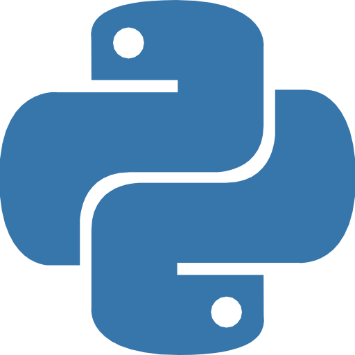
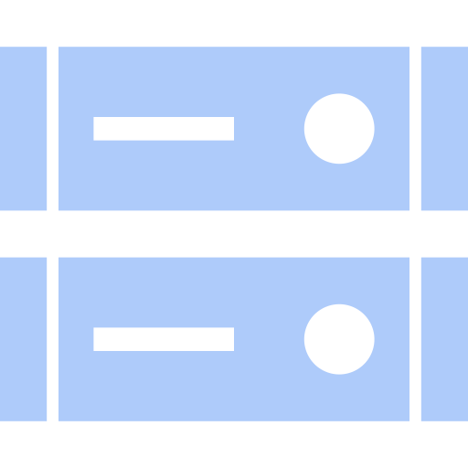
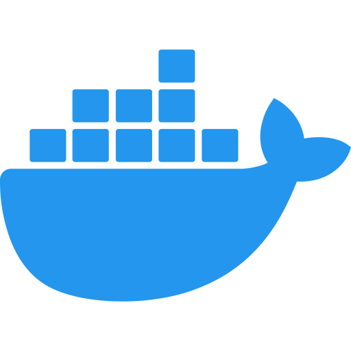
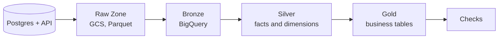

# StyleHub Data Pipeline

A learning project that moves online shop data from Postgres into BigQuery. The data passes through Raw, Bronze, Silver and Gold layers on Google Cloud.

## Tech Stack

| Category | Technologies |
|---|---|
| **Programming** |  Python  •  SQL  •  python-dotenv |
| **Data Storage** |  Google Cloud Storage  •   BigQuery  •   PostgreSQL (source)  •   Parquet |
| **Data Processing** |  pandas  •   PyArrow |
| **Tooling** |  uv  •   Make  •  Ruff  •   pytest |
| **DevOps** |  Docker and Docker Compose  •   GitHub Actions  •  pre-commit  •  gitleaks |

> [!NOTE]
> This is a personal project built while following a 5-session data engineering course. The Python tests pass, including tests against a real Postgres. The SQL has **not** run on a real BigQuery project yet. See [Troubleshooting & Limitations](#troubleshooting--limitations).

## Overview

**Problem.** StyleHub is a course dataset. It has five shop tables (users, products, orders, order_items, shipments) and an `events` table with about 108 million rows. Reports on the shop database can slow down the shop. The raw tables are also hard to use. Ids repeat, column types are loose, and each report may define "revenue" in its own way.

**Solution.** The pipeline copies raw data to cloud storage first. It loads the data into Bronze without changes. It then builds clean Silver tables, one row per fact or per thing. Gold tables answer business questions with clear rules. Each step runs alone and is safe to run again.

**Data Flow.** Postgres + API → Raw Zone (GCS) → Bronze → Silver → Gold → Checks



## Architecture

### Code layers

| Layer | Responsibility | Files |
|---|---|---|
| Ingestion | Read rows from Postgres. Write raw Parquet files. Nothing else. | `ingestion/` |
| Load | Append Raw files into Bronze tables. | `pipeline/load_bronze.py` |
| Transform | Run the SQL files of one layer in order. | `pipeline/run_sql.py`, `sql/` |
| Checks | Run SQL checks. A check passes when it returns zero rows. | `pipeline/checks.py`, `sql/checks/` |
| Runner | Run all steps for one date. | `pipeline/run_daily.py` |
| Config | Read environment variables. Fill `${project}` and similar names in SQL. | `pipeline/config.py` |

### Data layers

| Layer | Where | Contents |
|---|---|---|
| Raw Zone | GCS: `raw/stylehub/<table>/date=<date>/batch_id=<id>/` | Files as fetched. Each has `_ingested_at`, `_source` and `_batch_id`. |
| Bronze | BigQuery: `stylehub_bronze` | A copy of the source. Every version of a row stays. |
| Silver | BigQuery: `stylehub_silver` | One latest row per id, with correct types. Built as a star schema. |
| Gold | BigQuery: `stylehub_gold` | Business tables that hold the rules. |

### Silver and Gold tables

| Table | Layer | What one row means |
|---|---|---|
| `fact_order_items` | Silver | One item in an order |
| `fact_orders` | Silver | One order |
| `fact_shipments` | Silver | One shipment |
| `dim_products` | Silver | One product |
| `dim_users` | Silver | One customer |
| `daily_revenue` | Gold | Orders and revenue for one day (no Cancelled orders) |
| `monthly_revenue_by_category` | Gold | Revenue and profit for one category in one month |
| `return_rate_by_state` | Gold | Share of returned orders in one state |
| `avg_delivery_days_by_state` | Gold | Average delivery time in one state |

### Key design decisions

| Decision | How it works |
|---|---|
| Raw Zone is append-only | Each run writes a new file under a new `batch_id`. Nothing is overwritten. |
| Bronze keeps duplicates | Running a day twice adds rows twice. Silver removes them. |
| Latest row per id | Silver keeps the newest version of each id with `QUALIFY ROW_NUMBER()`. |
| Lookback window | Ingestion reads one extra day before the target date. This catches late rows. |
| Rules live in Gold | Gold drops `Cancelled` orders. If the rule changes, rebuild Gold only. |
| Grain comes first | Each Silver file states its grain at the top. A check compares row count with distinct id count. |
| Partition and cluster | `events_partitioned` is split by day and clustered by `event_type` and `product_id`. |
| Logic stays in SQL | SQL files hold the business logic. Python only runs them. |
| CTEs, no subqueries | Every SQL file uses CTEs. A test fails if it finds a subquery. |

## Project Structure

```
.
├── .github/
│   ├── workflows/ci.yml     # Checks that run on every pull request
│   └── pull_request_template.md
├── assets/                  # Icons used in this README
├── deploy/                  # Script and systemd timers to run on a VM
├── docker/
│   └── postgres/init/       # Sample data for the local Postgres
├── docs/
│   ├── ARCHITECTURE.md      # Layers, star schema, Airbyte sync modes
│   ├── DECISIONS.md         # Design choices and measurements
│   ├── DEPLOY_VM.md         # Run the pipeline on a GCP VM
│   ├── DEVOPS.md            # CI, Docker, pre-commit and what comes next
│   ├── EXTENDING.md         # How to add dbt, Airflow and Spark later
│   └── ROADMAP.md           # Plan by course session
├── ingestion/
│   ├── incremental.py       # Postgres -> Raw Zone, with a watermark
│   └── raw_writer.py        # Write Parquet and metadata columns to GCS
├── notebooks/               # Homework notebooks, one folder per session
├── pipeline/
│   ├── alerts.py            # Send a message when a step fails
│   ├── checks.py            # Run the data checks
│   ├── config.py            # Settings and SQL placeholders
│   ├── load_bronze.py       # Raw Zone -> Bronze (append)
│   ├── run_daily.py         # Run all steps for one date, with logs and alerts
│   ├── run_sql.py           # Run the SQL files of one layer
│   └── runs.py              # Save one row per step in BigQuery
├── sql/
│   ├── bronze/              # Table setup (partitioned events)
│   ├── silver/              # Facts and dimensions
│   ├── gold/                # Business tables
│   ├── ops/                 # The pipeline_runs table
│   └── checks/              # Quality checks
├── tests/                   # Unit tests and integration tests
├── .dockerignore
├── .env.example             # Names of the settings. Copy to .env.
├── .gitignore
├── .pre-commit-config.yaml  # Checks that run before each commit
├── CLAUDE.md                # Rules for AI assistants and contributors
├── Dockerfile               # Image for the pipeline
├── docker-compose.yml       # Local Postgres with sample data
├── Makefile                 # Short commands
├── pyproject.toml           # Dependencies and tool settings
├── README.md
└── uv.lock                  # Exact package versions
```

> [!TIP]
> Read `CLAUDE.md` before you change code. It lists the rules for SQL, ingestion and secrets.

## Quick Start

### Prerequisites

| Item | Notes |
|---|---|
| Python 3.11 or newer | Check with `python --version`. |
| [uv](https://docs.astral.sh/uv/) | Installs the packages. |
| Google Cloud project | Turn on the BigQuery and Cloud Storage APIs. |
| GCS bucket | Holds the Raw Zone. |
| Three BigQuery datasets | `stylehub_bronze`, `stylehub_silver`, `stylehub_gold`. Use the same location as the bucket. |
| Service account key (JSON) | Save it in `secrets/`. Give the account BigQuery Job User, BigQuery Data Editor and Storage Object Admin. |
| Read-only Postgres access | Host, database, user and password come from the course. |
| Docker Desktop (optional) | For the local Postgres and the image. You can try ingestion without any cloud account. |
| Make (optional) | Not installed on Windows by default. Every command below also works without it. |

> [!IMPORTANT]
> The StyleHub dataset belongs to the course. This repo holds only code. Do not commit course data or course materials.

### Setup

```powershell
git clone https://github.com/wayneworkspace/PROJECT_Stylehub-Data-Platform.git
cd PROJECT_Stylehub-Data-Platform
uv sync --extra dev
copy .env.example .env
uv run pytest
```

Open `.env` and fill in your values. See [Configuration](#configuration).

### Try it with Docker (no cloud needed)

The local Postgres holds a small set of sample orders. You can test the extraction step with it. Nothing is written to GCS.

```powershell
docker compose up -d postgres
docker compose run --rm pipeline python -m ingestion.incremental --table orders --date 2026-10-01 --dry-run
```

The second command should print `orders 2026-10-01: 24 rows (dry run, nothing written)`. To run the integration tests against the same database:

```powershell
$env:PG_HOST = "localhost"; $env:PG_PORT = "5432"; $env:PG_DATABASE = "stylehub"
$env:PG_USER = "stylehub"; $env:PG_PASSWORD = "stylehub_local"
uv run pytest -m integration
docker compose down -v
```

To build the image alone, run `docker build -t stylehub-pipeline .`

> [!NOTE]
> The password `stylehub_local` is for this throwaway local database only. The port is open to your own computer and no one else.

### First run

```powershell
$d = "2026-10-01"

# One time: build the partitioned events table (scans the whole source table)
uv run python -m pipeline.run_sql bronze

# Postgres -> Raw Zone -> Bronze
uv run python -m ingestion.incremental --table orders --date $d
uv run python -m ingestion.incremental --table order_items --date $d
uv run python -m pipeline.load_bronze --date $d --table orders
uv run python -m pipeline.load_bronze --date $d --table order_items

# Bronze -> Silver -> Gold, then checks
uv run python -m pipeline.run_sql silver
uv run python -m pipeline.run_sql gold
uv run python -m pipeline.checks
```

To see how many bytes a layer would scan without running it, add `--dry-run`:

```powershell
uv run python -m pipeline.run_sql gold --dry-run
```

> [!WARNING]
> `pipeline.run_daily` and `pipeline.load_bronze` without `--table` load all five tables. This repo only creates Raw files for `orders` and `order_items`. The other three tables must come from Airbyte or a manual upload first. Until then, use `--table`.

If you have Make, these shortcuts do the same work:

```bash
make ingest DATE=2026-10-01
make bronze DATE=2026-10-01
make silver
make gold
make check
```

### Daily run

| Option | How |
|---|---|
| By hand | `uv run python -m pipeline.run_daily --date 2026-10-01` |
| Start or stop at a step | Add `--from-step silver` or `--to-step bronze` (steps: ingest, bronze, silver, gold, checks). |
| See what ran | Each step is saved in the BigQuery table `stylehub_ops.pipeline_runs`: status, time, rows and error. |
| Get alerts | Set `ALERT_WEBHOOK_URL` to a Discord webhook. A failed step sends one message. |
| On a schedule | Use the systemd timers in `deploy/`. See [docs/DEPLOY_VM.md](docs/DEPLOY_VM.md). Airflow is a later option (see [docs/EXTENDING.md](docs/EXTENDING.md)). |

### Checks before you commit

| Check | How | When it runs |
|---|---|---|
| Pre-commit hooks (ruff, gitleaks, file checks) | Run `uvx pre-commit install` once. | On every `git commit` |
| Unit tests | `uv run pytest` | You run them before you push |
| Integration tests | `uv run pytest -m integration` (needs the Docker Postgres) | You run them before you push |
| CI on GitHub | Same checks, plus a Docker build | On every pull request |

See [docs/DEVOPS.md](docs/DEVOPS.md) for what each CI job does.

## Configuration

| Item | Where | Notes |
|---|---|---|
| `GCP_PROJECT_ID` | `.env` | Required. |
| `GCS_BUCKET` | `.env` | Required. Bucket name only, with no `gs://`. |
| `GOOGLE_APPLICATION_CREDENTIALS` | `.env` | Path to the service account JSON, for example `./secrets/gcp-sa.json`. Never commit it. |
| `RAW_PREFIX` | `.env` | Folder for Raw files. Default `raw/stylehub`. |
| `BQ_SOURCE` | `.env` | Dataset with the course's original tables, such as `events`. Default `stylehub`. |
| `BQ_BRONZE`, `BQ_SILVER`, `BQ_GOLD` | `.env` | Dataset names. Defaults `stylehub_bronze`, `stylehub_silver`, `stylehub_gold`. |
| `PG_HOST`, `PG_PORT`, `PG_DATABASE`, `PG_USER`, `PG_PASSWORD` | `.env` | Read-only Postgres source. Never commit the password. |
| `LOCAL_PG_PASSWORD` | Your shell (optional) | Password for the local Docker Postgres. Default `stylehub_local`. |
| `BQ_OPS` | `.env` | Dataset for `pipeline_runs`. Default `stylehub_ops`. Create it before the first run. |
| `ALERT_WEBHOOK_URL` | `.env` (optional) | Discord webhook for failure alerts. It is a secret. Leave it empty to turn alerts off. |
| `GCP_REGION`, `STYLEHUB_API_KEY` | `.env` | Listed in `.env.example`, but no code reads them yet. |
| Watermark column | `WATERMARK` in `ingestion/incremental.py` | One column per table. Both tables use `updated_at` for now. |
| Lookback days | `LOOKBACK_DAYS` in `ingestion/incremental.py` | Default 1. |
| Raw folder names | `RAW_DIR` in `pipeline/config.py` | Needed when a folder name differs from the table name. `products` uses `products_api`. |

> [!WARNING]
> Never commit `.env`, `secrets/`, GCP keys or passwords. `.gitignore` blocks them, but check `git status` before each commit.

## Troubleshooting & Limitations

### Troubleshooting

| Symptom | Cause and fix |
|---|---|
| `KeyError: 'GCP_PROJECT_ID'` (or `PG_HOST`) | `.env` is missing or incomplete. Copy `.env.example` to `.env` and fill it in. |
| `403` or "permission denied" | The service account lacks a role. Add the roles in the prerequisites table. |
| `Not found: Dataset ...` | A dataset does not exist. Create all three datasets in the bucket's location. |
| `load_bronze` says no files match | No Raw files exist for that table and date. Run ingestion first, or use `--table` for a table you have. |
| "Unrecognized name" in a Silver query | The SQL used a guessed column name. Check the real columns in `INFORMATION_SCHEMA.COLUMNS` and edit the SQL file. |
| Bronze row count grows after a re-run | This is by design. Silver removes the duplicates. |
| `make` is not found on Windows | Use the `uv run` commands. |
| `pytest` says tests were "deselected" | Integration tests are off by default. Start the Docker Postgres and add `-m integration`. |
| `docker compose up` says port 5432 is in use | Another Postgres runs on your computer. Stop it, or change the port in `docker-compose.yml`. |
| A commit fails and files changed | A pre-commit hook fixed them, for example trailing spaces. Run `git add` again and commit again. |
| A commit is blocked by gitleaks | It found something that looks like a key. Remove the secret first. If it was a real key, rotate it. |

### Limitations

| Area | Limitation |
|---|---|
| Testing | Unit tests cover paths, date windows and SQL placeholders. Integration tests cover extraction from a sample Postgres. The SQL has never run on real BigQuery data. |
| Schema | Column names for `users` and `shipments` come from course slides, not from the real schema. |
| Sources | Python ingestion covers `orders` and `order_items` only. `products` (API), `users` and `shipments` need Airbyte or a manual upload. |
| Watermark | `order_items` uses `updated_at` without a check on real data. See `docs/DECISIONS.md`. |
| Deletes | The pipeline cannot see rows that the source deletes. |
| Scheduling | Timers run each job once a day. There are no retries. A failed step stops the run until the next day or a manual run. |
| Logging | `run_daily` uses `logging`. The ingestion, Bronze and SQL scripts still use `print` when you run them alone. |
| Run history | Only `run_daily` writes to `pipeline_runs`. Recording is best effort: if BigQuery is down, the row is lost. Only the Bronze step counts rows. |
| Alerts | One Discord message per failed step. Nothing alerts you if the VM or the timer does not run at all. |
| VM | The VM files in `deploy/` have not run on a real GCP project. |
| Docker | CI builds the image, but it is not pushed to a registry or run on a server yet. |
| Rebuilds | Silver and Gold use `CREATE OR REPLACE TABLE`. Each run rebuilds the whole table. |
| Events | `events` is only partitioned. There is no `fact_events` or `dim_date` yet. |
| Backups | None. |
| Dependencies | `uv.lock` pins exact versions. Update them on purpose with `uv lock --upgrade`. |
| Scale | A learning project that uses a course dataset. Do not use it for real business reports. |

## Roadmap

- [ ] Run the SQL on real BigQuery data and fix column names
- [ ] Measure the `events` queries and fill in `docs/DECISIONS.md`
- [ ] Add Python ingestion for `products` (API), `users` and `shipments`
- [ ] Add `fact_events` and `dim_date`
- [ ] Add daily sample data so the pipeline runs on new rows
- [ ] Add an architecture diagram image
- [x] Add logging, a run history table and failure alerts
- [ ] Run the pipeline on a small GCP VM and fix what breaks (files are ready in `deploy/`)
- [ ] Add retries and an alert for a job that did not run
- [ ] Describe the bucket, datasets and service accounts in Terraform
- [ ] Add dbt, Airflow and Spark (see [docs/EXTENDING.md](docs/EXTENDING.md))
