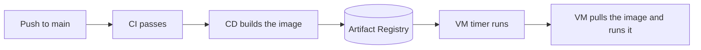

# CD: publish the image, and the VM pulls it

> [!NOTE]
> Airflow schedules the pipeline (see [deploy/airflow/README.md](../../deploy/airflow/README.md)). This page covers only how the image is published and how a VM pulls it. The VM script is `deploy/pipeline/run_on_vm.sh`.

CI checks the code. CD ships it. After CI passes on `main`, GitHub pushes the Docker images that CI built and tested to Google Artifact Registry: `stylehub-pipeline` (the VM script, runs by hand) and `stylehub-airflow` (the image that runs the DAG every day). Both get the same tag, the commit id.

GitHub never connects to the VM. So there is no SSH key in GitHub and no open port on the VM.

> [!WARNING]
> The workflow has run on GitHub and was green: it signs in with Workload Identity Federation and pushes the image. The VM part has not run yet, because no VM has pulled the image. The script passes a test with a fake `docker`. You are the first person to run that part. Fix what breaks and update this page.

## How it flows



| Part | File | What it does |
|---|---|---|
| CD workflow | `.github/workflows/cd.yaml` | Runs only when CI succeeded on a push to `main`. It does not build again: it downloads the two images that CI built and tested (artifacts `pipeline-image` and `airflow-image`), and pushes each with one tag, the commit id. There is no `latest` tag. |
| Login without a key file | Workload Identity Federation | GitHub proves who it is with a short-lived token. No JSON key is stored in GitHub. |
| VM script | `deploy/pipeline/run_on_vm.sh` | If `STYLEHUB_IMAGE` is set, it logs in with the VM's own token (no key file), pulls the image and runs it. It refuses `:latest` and untagged names. |

## One-time setup

Run these in Cloud Shell (bash). Replace `PROJECT`, `PROJECT_NUMBER`, `REGION` (for example `asia-southeast1`) and `OWNER/REPO` (your GitHub repo).

```bash
gcloud services enable artifactregistry.googleapis.com iamcredentials.googleapis.com sts.googleapis.com --project PROJECT

# 1. A place for the images
gcloud artifacts repositories create stylehub --repository-format=docker \
  --location=REGION --project PROJECT

# 2. A service account that GitHub may use. It can only write to this one repository.
gcloud iam service-accounts create sa-github-cd --project PROJECT
gcloud artifacts repositories add-iam-policy-binding stylehub --location=REGION --project PROJECT \
  --member serviceAccount:sa-github-cd@PROJECT.iam.gserviceaccount.com --role roles/artifactregistry.writer

# 3. Let GitHub act as sa-github-cd, but only for your repo
gcloud iam workload-identity-pools create github --project PROJECT --location=global
gcloud iam workload-identity-pools providers create-oidc github-repo \
  --project PROJECT --location=global --workload-identity-pool=github \
  --issuer-uri=https://token.actions.githubusercontent.com \
  --attribute-mapping="google.subject=assertion.sub,attribute.repository=assertion.repository" \
  --attribute-condition="assertion.repository=='OWNER/REPO'"
gcloud iam service-accounts add-iam-policy-binding sa-github-cd@PROJECT.iam.gserviceaccount.com \
  --project PROJECT --role roles/iam.workloadIdentityUser \
  --member "principalSet://iam.googleapis.com/projects/PROJECT_NUMBER/locations/global/workloadIdentityPools/github/attribute.repository/OWNER/REPO"

# 4. Let the two VM jobs read (not write) the images
for sa in sa-ingest sa-transform; do
  gcloud artifacts repositories add-iam-policy-binding stylehub --location=REGION --project PROJECT \
    --member serviceAccount:$sa@PROJECT.iam.gserviceaccount.com --role roles/artifactregistry.reader
done
```

Then save five GitHub **variables** (not secrets, none of them is a password). In PowerShell, with the GitHub CLI:

```powershell
gh variable set GCP_PROJECT_ID --body "PROJECT"
gh variable set GCP_REGION --body "REGION"
gh variable set AR_REPOSITORY --body "stylehub"
gh variable set WIF_PROVIDER --body "projects/PROJECT_NUMBER/locations/global/workloadIdentityPools/github/providers/github-repo"
gh variable set WIF_SERVICE_ACCOUNT --body "sa-github-cd@PROJECT.iam.gserviceaccount.com"
```

Last, tell the VM which image to use. Add one line to `/etc/stylehub/pipeline.env`:

```
STYLEHUB_IMAGE=REGION-docker.pkg.dev/PROJECT/stylehub/stylehub-pipeline:<git-sha>
```

## Check that it works

| Check | How |
|---|---|
| CD ran | GitHub > Actions > the "CD" run is green after "CI". |
| The image is there | `gcloud artifacts docker images list REGION-docker.pkg.dev/PROJECT/stylehub --include-tags` |
| The VM can pull | `sudo DATA_DATE=2026-10-01 /opt/stylehub/deploy/pipeline/run_on_vm.sh ingest ingest` prints the pull, then the run. |

## dbt build in CI

`.github/workflows/dbt-ci.yaml` runs the dbt models and tests on BigQuery for every pull request
and every push to `main`. It writes only to the dev datasets `dbt_ci_stylehub_silver` and
`dbt_ci_stylehub_gold` and reads the real Bronze tables. Set it up once:

| Where | What to set |
|---|---|
| Google Cloud | A service account `sa-dbt-ci` with `bigquery.jobUser` on the project, `bigquery.dataViewer` on the Bronze dataset and `bigquery.dataEditor` on its own `dbt_ci_*` datasets. Let GitHub use it with Workload Identity Federation, the same way as above. |
| GitHub repository variables | `WIF_PROVIDER`, `WIF_CI_SERVICE_ACCOUNT`, `GCP_PROJECT_ID`, `GCS_BUCKET` (and `GCP_LOCATION` if it is not `asia-southeast1`) |

The job is skipped until `WIF_CI_SERVICE_ACCOUNT` is set, and a pull request from a fork is skipped
(it has no access to the cloud). The first run builds `fact_events` completely (about 15 GB of
scan); later runs only rebuild the newest days.

## Roll back

Set `STYLEHUB_IMAGE` to an older commit tag (`...stylehub-pipeline:<git-sha>`) or a digest (`...stylehub-pipeline@sha256:<digest>`). The next run uses that exact version. Every tag is the commit id, so you can always find the code of a running image.

## Limits

| Area | Limit |
|---|---|
| Deploy | The VM updates only when a job runs on it, not the moment you push. |
| Version pins | Actions are pinned by commit SHA. The base images are pinned by version and by digest (read on 2026-10-16), and uv by version. Dependabot opens pull requests for updates. |
| No smoke test | CD pushes the image and stops. Nothing starts it on the VM, and no job checks that the new image really runs there. Run `run_daily --help` from the new image by hand before you switch `STYLEHUB_IMAGE`. |
| Old images | They stay in Artifact Registry and cost a little storage. Add a cleanup rule later. |
| Terraform | `infra/terraform/` makes the same resources as these commands. See [TERRAFORM.md](TERRAFORM.md). It has not been run yet. |
