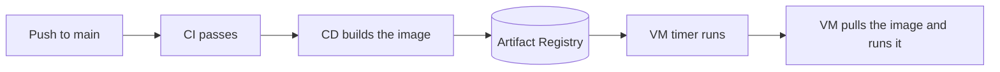

# CD: publish the image, and the VM pulls it

> [!NOTE]
> The systemd timers described here were removed from the repo. Airflow now schedules the pipeline (see [deploy/airflow/README.md](../../deploy/airflow/README.md)). Keep this page only as a starting point for a VM setup, and expect to adapt it. `deploy/pipeline/run_on_vm.sh` is still there.

CI checks the code. CD ships it. After CI passes on `main`, GitHub builds the Docker image and pushes it to Google Artifact Registry. The VM pulls the new image the next time a timer runs.

GitHub never connects to the VM. So there is no SSH key in GitHub and no open port on the VM.

> [!WARNING]
> I could not run these steps on a real GCP project or on GitHub. The workflow file and the script parse, and the script passes a test with a fake `docker`. You are the first person to run it end to end. Fix what breaks and update this page.

## How it flows



| Part | File | What it does |
|---|---|---|
| CD workflow | `.github/workflows/cd.yaml` | Runs only when CI succeeded on `main`. Builds the image. Pushes two tags: the commit id and `latest`. |
| Login without a key file | Workload Identity Federation | GitHub proves who it is with a short-lived token. No JSON key is stored in GitHub. |
| VM script | `deploy/pipeline/run_on_vm.sh` | If `STYLEHUB_IMAGE` is set, it logs in with the job's own key, pulls the image and runs it. |

## One-time setup

Run these in Cloud Shell (bash). Replace `PROJECT`, `PROJECT_NUMBER`, `REGION` (for example `asia-southeast1`) and `OWNER/REPO` (your GitHub repo).

```bash
gcloud services enable artifactregistry.googleapis.com iamcredentials.googleapis.com sts.googleapis.com --project PROJECT

# 1. A place for the images
gcloud artifacts repositories create stylehub --repository-format=docker \
  --location=REGION --project PROJECT

# 2. A service account that GitHub may use. It can only write to this one repository.
gcloud iam service-accounts create sa-github-cd --project PROJECT
gcloud artifacts repositories add-iam-policy-binding stylehub --location=REGION --project PROJECT \
  --member serviceAccount:sa-github-cd@PROJECT.iam.gserviceaccount.com --role roles/artifactregistry.writer

# 3. Let GitHub act as sa-github-cd, but only for your repo
gcloud iam workload-identity-pools create github --project PROJECT --location=global
gcloud iam workload-identity-pools providers create-oidc github-repo \
  --project PROJECT --location=global --workload-identity-pool=github \
  --issuer-uri=https://token.actions.githubusercontent.com \
  --attribute-mapping="google.subject=assertion.sub,attribute.repository=assertion.repository" \
  --attribute-condition="assertion.repository=='OWNER/REPO'"
gcloud iam service-accounts add-iam-policy-binding sa-github-cd@PROJECT.iam.gserviceaccount.com \
  --project PROJECT --role roles/iam.workloadIdentityUser \
  --member "principalSet://iam.googleapis.com/projects/PROJECT_NUMBER/locations/global/workloadIdentityPools/github/attribute.repository/OWNER/REPO"

# 4. Let the two VM jobs read (not write) the images
for sa in sa-ingest sa-transform; do
  gcloud artifacts repositories add-iam-policy-binding stylehub --location=REGION --project PROJECT \
    --member serviceAccount:$sa@PROJECT.iam.gserviceaccount.com --role roles/artifactregistry.reader
done
```

Then save five GitHub **variables** (not secrets, none of them is a password). In PowerShell, with the GitHub CLI:

```powershell
gh variable set GCP_PROJECT_ID --body "PROJECT"
gh variable set GCP_REGION --body "REGION"
gh variable set AR_REPOSITORY --body "stylehub"
gh variable set WIF_PROVIDER --body "projects/PROJECT_NUMBER/locations/global/workloadIdentityPools/github/providers/github-repo"
gh variable set WIF_SERVICE_ACCOUNT --body "sa-github-cd@PROJECT.iam.gserviceaccount.com"
```

Last, tell the VM which image to use. Add one line to `/etc/stylehub/pipeline.env`:

```
STYLEHUB_IMAGE=REGION-docker.pkg.dev/PROJECT/stylehub/stylehub-pipeline:latest
```

## Check that it works

| Check | How |
|---|---|
| CD ran | GitHub > Actions > the "CD" run is green after "CI". |
| The image is there | `gcloud artifacts docker images list REGION-docker.pkg.dev/PROJECT/stylehub --include-tags` |
| The VM can pull | `sudo DATA_DATE=2026-10-01 /opt/stylehub/deploy/pipeline/run_on_vm.sh ingest ingest /etc/stylehub/ingest-sa.json` prints the pull, then the run. |

## Roll back

Set `STYLEHUB_IMAGE` to a commit tag instead of `latest`, for example `...stylehub-pipeline:<git-sha>`. The next run uses that exact version.

## Limits

| Area | Limit |
|---|---|
| Deploy | The VM updates only when a timer runs, not the moment you push. |
| Version pins | `google-github-actions/auth@v3` is pinned to the major version. Pin a full tag after you check the latest release. |
| Old images | They stay in Artifact Registry and cost a little storage. Add a cleanup rule later. |
| Terraform | The commands above are typed by hand. Terraform can describe them later. |
